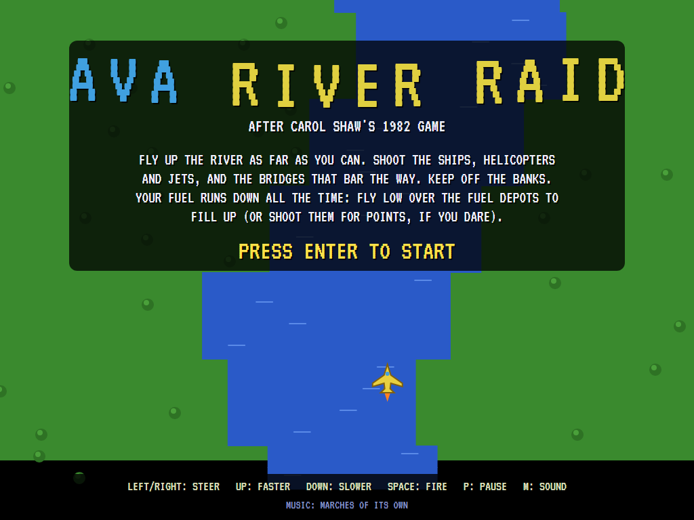
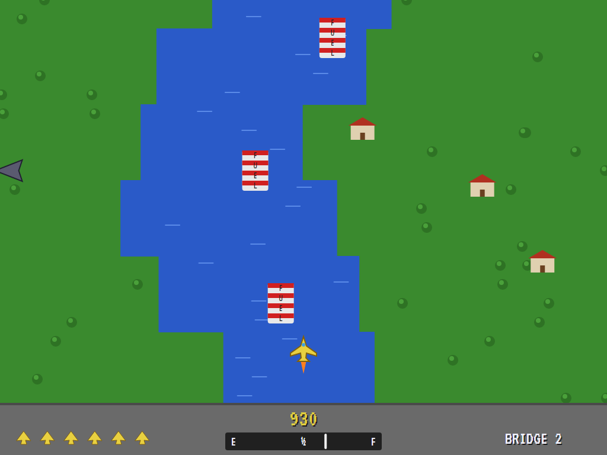
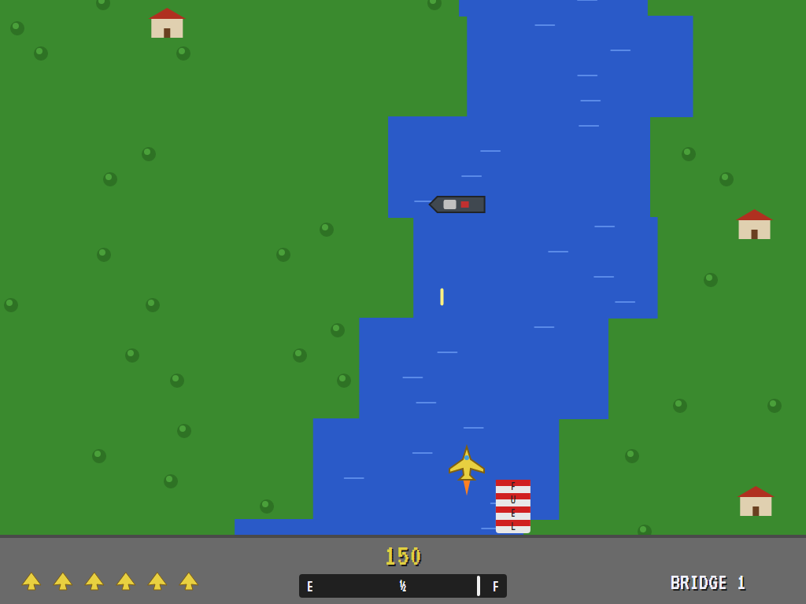
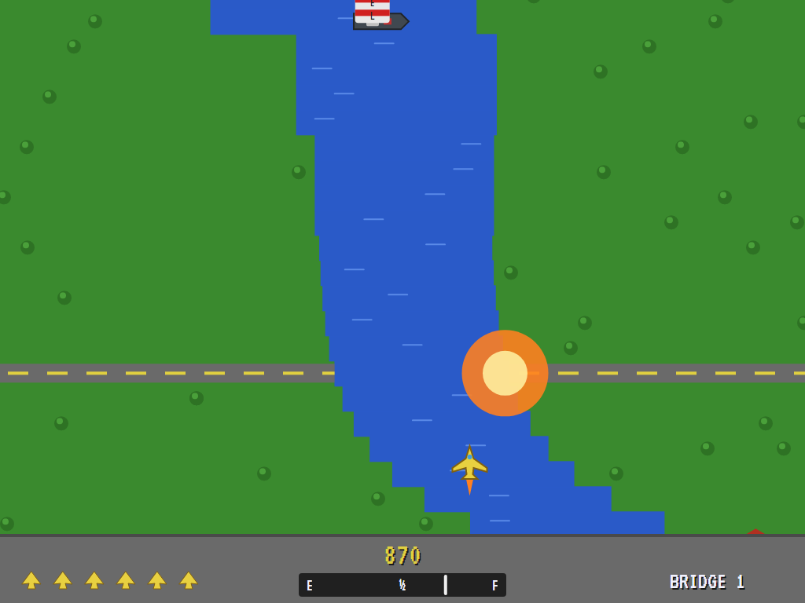
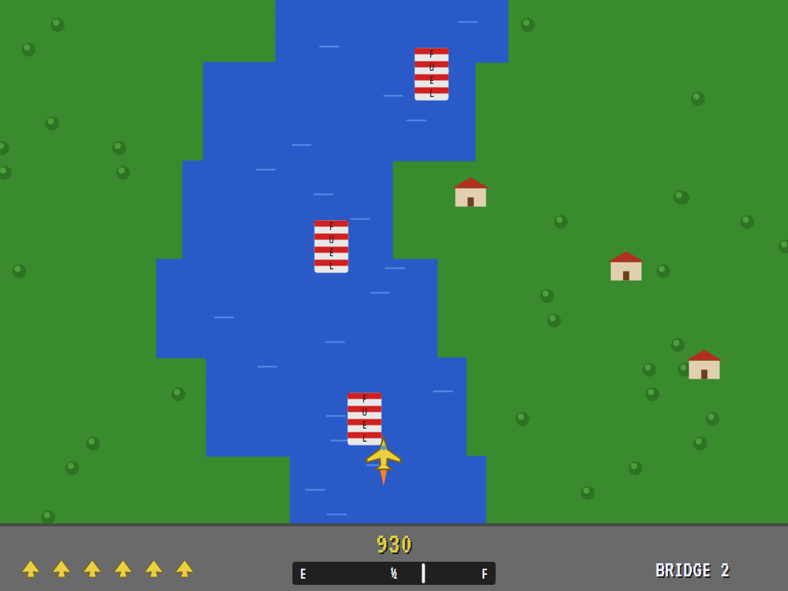
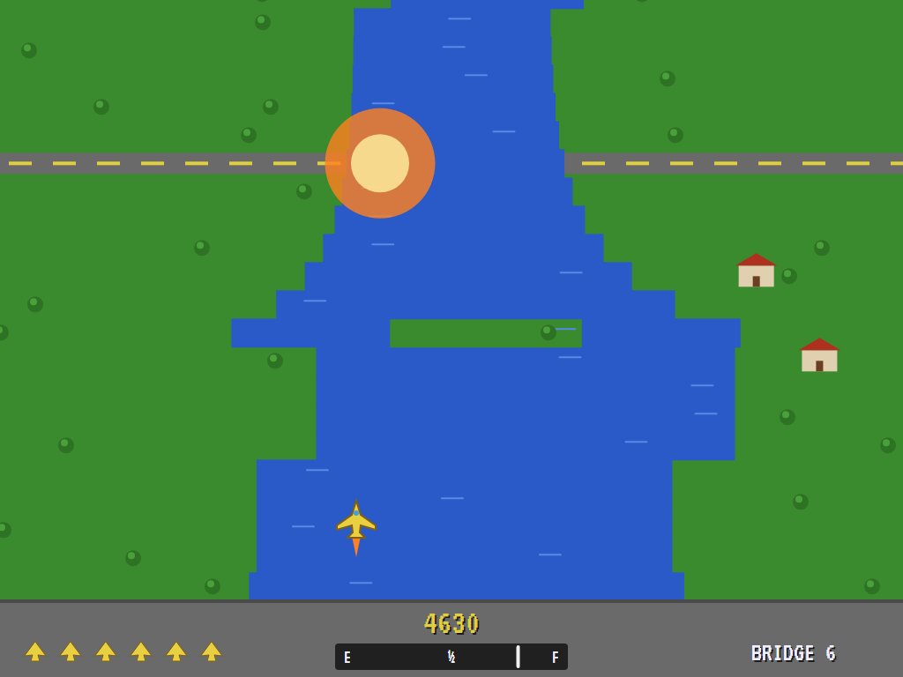
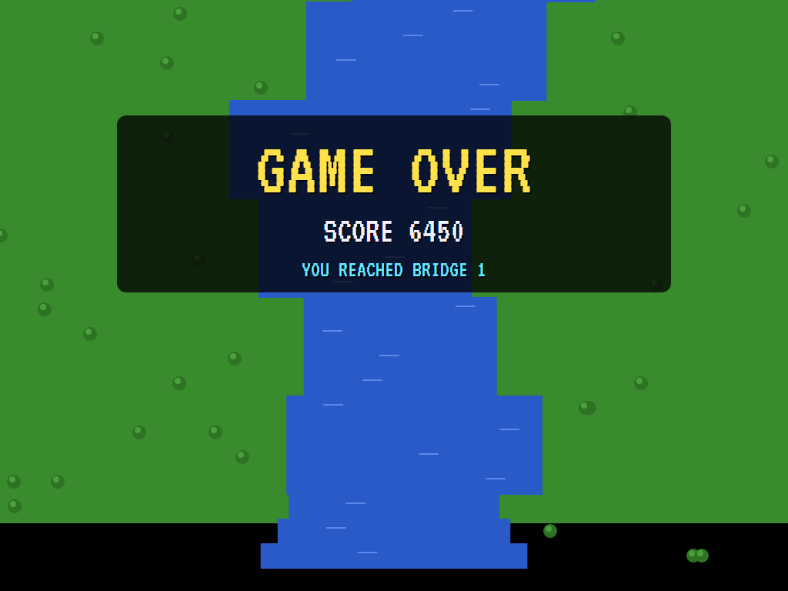
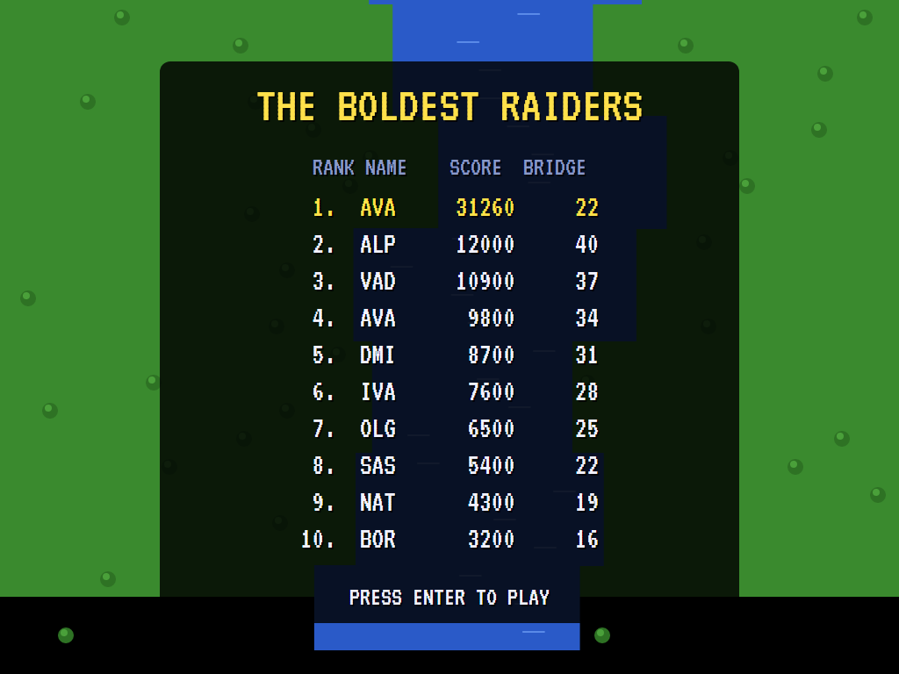

# AVA River Raid

[](https://github.com/Harlock123/AVARiverRaid/actions/workflows/build.yml)

A vertically scrolling shooter in the style of Carol Shaw's 1982 Activision game **River Raid**, built with .NET 10
and Avalonia UI. Fly up the river as far as you can. Shoot the ships, helicopters and jets, and the bridges that
bar the way, and keep off the banks. Your fuel runs down all the time, so fly low over the fuel depots to fill up.

## Features

- **A river of 48 sections**, built from a seed. The banks wind, the river narrows and widens, islands
  split it, and every section ends at a bridge with a road across the land. The river grows narrower and
  busier as you go.
- **Flying:** steer left and right, speed up or slow down. The plane fires one missile at a time.
- **On the river:** ships (30 points) and helicopters (60) patrol once you come near, and jets (100) cross
  the screen. Fuel depots (80, if you shoot one) come at least two to a section. Bridges are worth 500 and
  must come down before you can pass.
- **Fuel** lasts about 28 seconds; flying over a depot fills the tank, faster the slower you go. Run dry, hit
  a bank, a bridge or anything else on the river, and you crash.
- **Four planes**, and another every 10,000. After a crash you start again from the last bridge you
  brought down, with the section as it was and a full tank.
- **The attract mode** shows the computer pilot at work. Each moment it tries every way of flying (left,
  right or straight; slow, cruising or fast), each followed by the best way after it, on a copy of the river
  a second ahead. It takes the one that comes through furthest, clear of the banks, and over a fuel depot
  when the tank is getting low. It fires at anything ahead in its line, bridges included, but leaves the
  fuel depots alone unless the tank is nearly full.

## Screenshots

| The title | Up the river | A shot |
|:---------:|:------------:|:------:|
|  |  |  |

| A bridge | Refuelling | An island |
|:--------:|:----------:|:---------:|
|  |  |  |

| Game over | The boldest raiders |
|:---------:|:-------------------:|
|  |  |

The screenshots are made by the tests, which play the game in a real (headless) window; see
[Tests](#tests).

## Download and run

Ready-to-run builds for Windows, macOS and Linux, on both Intel/AMD and ARM, are on the
[Releases page](https://github.com/Harlock123/AVARiverRaid/releases/tag/latest). **Latest build** is
rebuilt on every push to `main`. Each download is one self-contained executable: no .NET install is
needed.

| Platform | Archive |
|---|---|
| Windows | `AVARiverRaid-win-x64.zip`, `AVARiverRaid-win-x86.zip`, `AVARiverRaid-win-arm64.zip` |
| macOS | `AVARiverRaid-osx-arm64.tar.gz` (Apple silicon), `AVARiverRaid-osx-x64.tar.gz` (Intel) |
| Linux | `AVARiverRaid-linux-x64.tar.gz`, `AVARiverRaid-linux-arm64.tar.gz`, `AVARiverRaid-linux-arm.tar.gz` |

```bash
tar -xzf AVARiverRaid-linux-x64.tar.gz     # or linux-arm64, linux-arm, osx-arm64, osx-x64
./AVARiverRaid
```

On Windows, unzip and run `AVARiverRaid.exe`. On macOS, if Gatekeeper refuses to open it, run
`xattr -d com.apple.quarantine AVARiverRaid` once. Run with `--no-audio` for silence.

**Sound** comes through OpenAL Soft, built in for every platform. In a virtual machine the game
detects it and uses a larger audio buffer, so the sound doesn't break up.

**Gamepads** use SDL2, which is bundled for Windows, macOS and Intel/AMD Linux. ARM Linux builds need it
installed; without it the keyboard still works:

```bash
sudo apt install libsdl2-dev            # Debian / Ubuntu / Raspberry Pi OS
sudo pacman -S --needed sdl2-compat     # Arch / Omarchy
```

## Controls

| Action | Keyboard | Gamepad |
|---|---|---|
| Start | Enter or 1 | Start |
| Steer | Left/right arrows, or A/D | Left stick / D-pad |
| Faster / slower | Up / down (or W/S) | Up / down |
| Fire | Space, Z, X or Ctrl | A or B |
| Pause | P or Esc | Start |
| Sound on/off | M | |
| Screenshot | Ctrl+S (to your Pictures folder) | |

On the high-score table, type your initials, or use up/down and Space, then Enter.

## Tests

```bash
dotnet test AVARiverRaid.slnx
```

The game runs in fixed 60 Hz steps, so it plays the same at any frame rate. Everything that changes lives in
one world that can be copied. The tests check:

- **The river:** the same from the same seed, a narrow bridge ending every section; fuel in every section, and
  room to fly everywhere.
- **Flying:** cruising, fast and slow, and steering; the banks; fuel running down and out, and a depot
  filling the tank; a ship patrolling once the plane comes near.
- **Shooting:** a ship sunk and scored; a bridge crashed into, and a bridge shot down to pass.
- **Starting again:** at the start of the section, with its things back and the bridges behind still down.
- **The game:** lives running out and initials; the demonstration and high scores; pause; a copied world; the
  keys.
- **The computer pilot:** ten bridges without a crash; flying straight crashes before the first.

`tests/AVARiverRaid.Tests/PilotProbe.cs` reports how the computer pilot gets on, for tuning (`RIVER_PROBE=1`).
It flies all 48 sections without a crash, in about seven minutes. `RIVER_PROBE=lazy` flies straight and fires,
and crashes at the first bend.

The screenshot tests draw the real screen in a headless window. To refresh the README's pictures:

```bash
RIVER_SHOTS=$PWD/Images dotnet test tests/AVARiverRaid.Tests --filter ScreenshotTests
```

## Building

```bash
dotnet build AVARiverRaid.slnx
dotnet run --project src/AVARiverRaid
```

Needs the .NET 10 SDK. The sounds, music and voice are made by `tools/make_sounds.py` (standard-library
Python, with the formant voice in `tools/speech.py`): `python3 tools/make_sounds.py` rewrites
`src/AVARiverRaid/Sounds`.

## Project structure

```
AVARiverRaid/
├── AVARiverRaid.slnx
├── src/AVARiverRaid/
│   ├── Engine/
│   │   ├── GameEngine.cs        # States, lives, starting again, the demonstration
│   │   ├── Sim.cs               # Flying, fuel, the missile, what's on the river, crashes
│   │   ├── River.cs             # The 48 sections, built from a seed
│   │   ├── World.cs             # Everything that changes, kept together so it can be copied
│   │   ├── Pilot.cs             # The computer pilot (the demonstration, and the tests)
│   │   ├── HighScoreTable.cs, InitialsEntry.cs
│   │   ├── InputHandler.cs, ControllerManager.cs  # Keys and an SDL2 gamepad
│   │   └── SoundManager.cs      # Effects, music and voice through OpenAL
│   ├── Audio/                   # The OpenAL engine (from the author's AVABand)
│   ├── Views/GameCanvas*.cs     # The river, the plane and what's on the water, the gauges, the title
│   └── Sounds/                  # The synthesised effects, music and voice
├── tests/AVARiverRaid.Tests/    # Gameplay and screenshot tests
├── tools/make_sounds.py, tools/speech.py
└── Images/                      # Screenshots
```

## About and licence

AVA River Raid © 2026 Lonnie Watson, under the [MIT License](LICENSE).

*River Raid* © 1982 Activision (designed and programmed by Carol Shaw); the name *River Raid* belongs to its
current owner. AVA River Raid is an independent, unofficial game in its style. Its river, graphics, sounds and
code are its own; nothing is taken from the original game's program, graphics or sound. It is not affiliated
with or endorsed by any rights holder.
